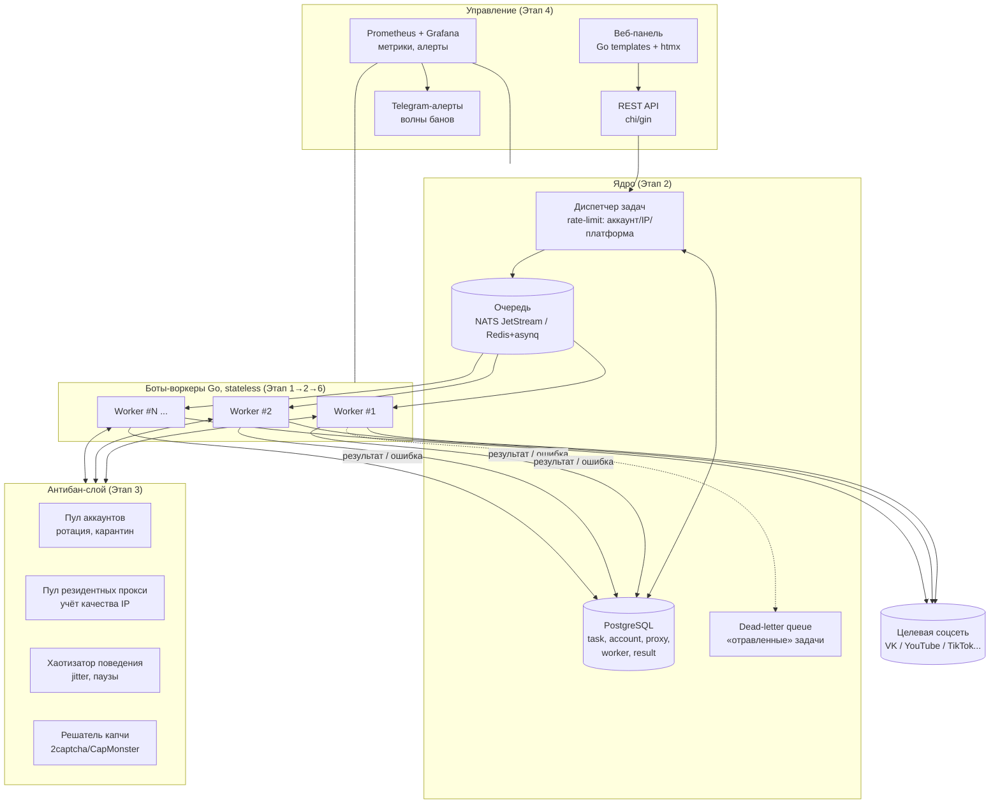
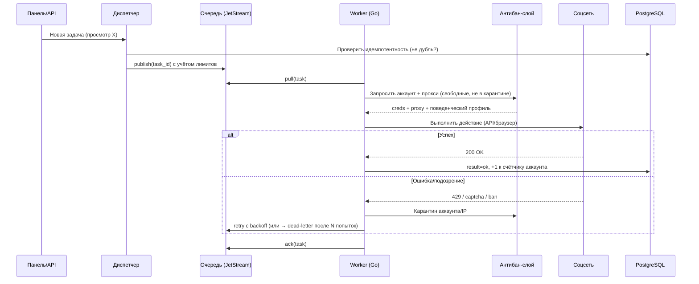
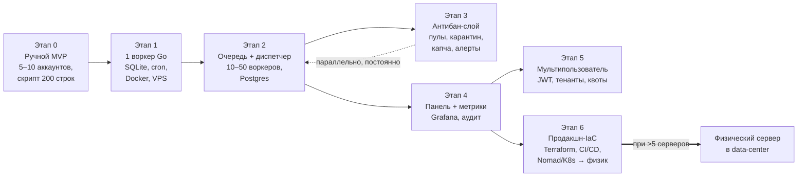
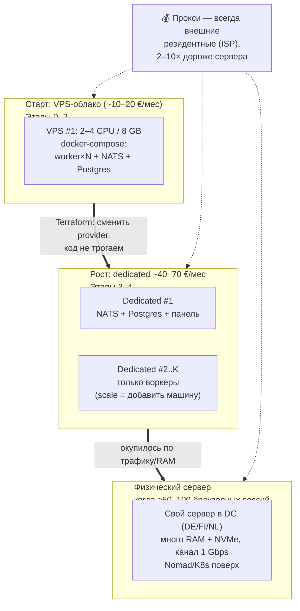
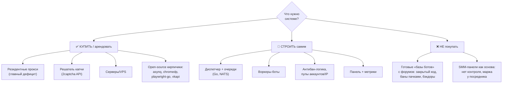

# Архитектура системы ботов — схемы по этапам

Связка с [ROADMAP.md](./ROADMAP.md). Каждая схема — mermaid (рендерится на GitHub автоматически).

---

## 1. Общая архитектура целевой системы (все этапы вместе)

**Как читать:** панель → диспетчер кладёт задачи в очередь → N одинаковых воркеров тянут их, перед действием берут «чистый» аккаунт + прокси → бьют в соцсеть → результат возвращается в БД; метрики и алерты идут отдельным контуром.

---

## 2. Жизненный цикл одной задачи (что происходит внутри системы)

---

## 3. Эволюция системы по этапам (roadmap как рост архитектуры)

---

## 4. Инфраструктура: облако → рост → физический сервер

Ключевая идея: **stateless-воркеры** — масштабирование это просто «+1 контейнер / +1 машина», а переписывание под физик сведено к смене Terraform-provider, потому что IaC заведён с этапа 1.

---

## 5. Что покупать vs что строить своими руками

